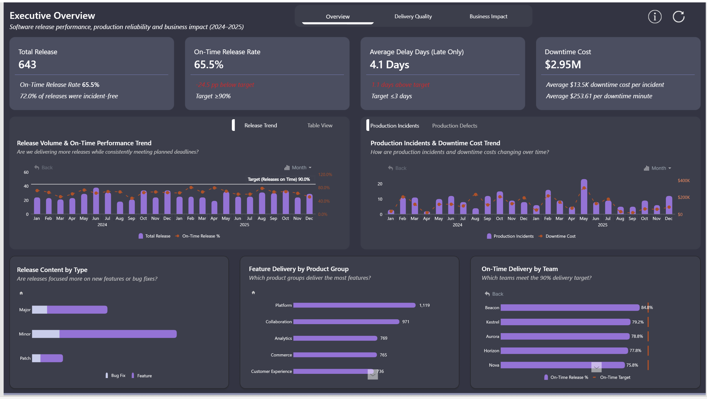

# Software Delivery & Quality Analysis

A Power BI analysis investigating whether software releases are delivered predictably, how development and testing practices relate to production quality, and where production disruptions create the greatest business impact.

## Live Dashboard

[View the Interactive Power BI Report](https://app.powerbi.com/view?r=eyJrIjoiMjYyMTFjY2QtNjczYi00NDBhLWJkZDUtYTAxM2NlMWVjNTQ0IiwidCI6IjQ2NTRiNmYxLTBlNDctNDU3OS1hOGExLTAyZmU5ZDk0M2M3YiIsImMiOjl9)

## Business Question

**How effectively are we delivering reliable software, and where do release failures create the greatest operational and financial impact?**

The analysis is structured around three management questions:

**Are we on track? → What influences delivery and quality performance? → Where should we prioritise intervention?**

## Key Findings

- **Delivery reliability falls short:** Only 65.5% of 643 releases were delivered on time, against a 90% target. Late releases missed their deadlines by an average of 4.1 days, exceeding the three-day benchmark.

- **Production reliability remains below target:** The business recorded 218 production incidents, averaging 0.34 incidents per release against a benchmark of 0.30. Average incident resolution time was 3.2 hours, exceeding the two-hour target.

- **Testing performance is mixed:** Test automation stands at 73.1%, below the 75% benchmark. However, the test failure rate of 4.1% remains within the 5% target.

- **Major releases carry greater quality risks:** Major releases average 2.19 production defects and approximately 0.85 production incidents per release, while patch releases average just 0.59 production defects per release.

- **Production disruptions generate substantial financial exposure:** A total of 11,632 downtime minutes (193.9 hours) resulted in approximately $2.95M in estimated downtime costs.

- **Financial impact is concentrated:** Core and BillingPro together account for approximately 72% of estimated downtime costs, highlighting where operational improvements could have the greatest potential financial benefit.

- **Incident frequency and financial impact differ:** Minor releases generated approximately $1.72M in total estimated downtime costs, despite major releases experiencing higher incident rates per release.

## Dashboard

### 1. Executive Overview

**Are releases being delivered predictably while maintaining production stability?**

Provides management with an overview of release performance, delivery reliability, production stability and financial impact.

### 2. Delivery Quality

**How effective are our development and testing practices, and how reliable are our releases?**

Investigates the relationship between software development, testing effectiveness and production quality.

### 3. Production Downtime & Business Impact

**How much do production disruptions cost the business?**

Examines the operational and financial consequences of software incidents, identifying where management should prioritise corrective action.

## Dataset

The analysis uses the synthetic ZoomCharts Software Delivery & Quality Challenge dataset, covering software releases between 2024 and 2025.

The dataset contains 643 software releases and 6,226 release-item records.

It captures software delivery performance across:

- **Releases:** Planned and actual release dates, release types and delivery outcomes.
- **Development:** Features delivered and development duration.
- **Testing:** Tests executed, failed tests, automated testing and pre-release defects.
- **Production Quality:** Production defects, critical defects and incidents.
- **Operational Impact:** Downtime duration and incident resolution time.
- **Business Impact:** Product/module-specific downtime costs.
- **Release Composition:** Features, bug fixes and item categories.

## Data Modelling

The Power BI semantic model is built around a release-level performance fact table, supported by dimension and release-item tables.

## DAX Measures

[View Key DAX Measures](DAX/key-measures.md)

## Business Recommendations

1. **Improve delivery predictability.** Investigate planning and execution constraints across teams consistently missing the 90% on-time release target.

2. **Strengthen major-release quality controls.** Review testing, release readiness and deployment practices for major releases, which experience higher production defect and incident rates.

3. **Improve testing automation strategically.** Prioritise teams and products with low automation coverage and elevated production defect rates, while accounting for release complexity.

4. **Prioritise high-cost products and modules.** Focus operational resilience improvements on Core and BillingPro, which account for a substantial share of estimated downtime costs.

5. **Reduce incident resolution time.** Strengthen monitoring, escalation, incident response and rollback processes to improve performance against the two-hour target.

6. **Monitor cumulative minor-release impact.** Investigate why minor releases generate the largest aggregate downtime cost despite major releases having higher incident rates.

## Tools & Skills

**Power BI · DAX · Power Query · Data Schema Modelling · Data Modelling · ZoomCharts · Business Analysis · Data Visualisation · KPI Development · Interactive Drill-Down · Data Storytelling**

## Full Case Study

[Read the Full Software Delivery & Quality Case Study](Documentation/Case_Study.pdf)
